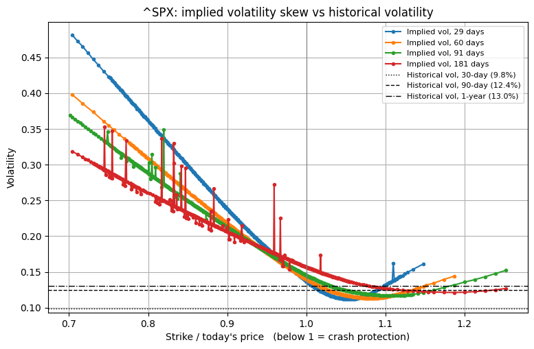

# Pricing Options with Finite Differences: Where Historical Volatility Fails

A finite difference (FDM) solver for the Black-Scholes equation, validated against the exact formula and then tested against real S&P 500 option prices using implied volatility.

📄 **Full methodology, results and discussion: [REPORT.md](REPORT.md)**

## Main finding

Pricing with historical volatility gets ordinary options roughly right, but values crash protection at almost nothing. A 29-day S&P 500 put with its strike 10% below the index costs **10.45 points** in the market. The FDM at historical volatility prices it at **0.06**. A seller using that model would be both underpaid and underhedged (holding about **2%** of the hedge the market's pricing implies) for exactly the event that hurts most.



If Black-Scholes were right, implied volatility would be flat across strikes. Instead, crash protection is priced as if the index were several times more volatile than its history suggests.

| Option (29 days) | Strike / index | Market price | Implied vol | FDM at historical vol (12.45%) | Gap |
|---|---|---|---|---|---|
| put | 0.90 | 10.45 | 23.8% | 0.06 | −99% |
| put | 0.95 | 28.00 | 18.4% | 6.38 | −77% |
| put | 1.00 | 101.40 | 13.7% | 90.49 | −11% |
| call | 1.05 | 9.10 | 11.3% | 13.47 | +48% |

## Background

This project began as a **summer research project at UCL**, which built and validated an explicit finite difference pricer for Black-Scholes and applied it to real stocks using historical volatility (Part 1). It was then extended with an implied volatility analysis against real S&P 500 option prices (Part 2), which tests where pricing with historical volatility fails. The report lists exactly [what was in the original project and what was added](REPORT.md#project-scope-original-work-and-extension).

## What the project does

1. **Builds and validates the pricer.** An explicit finite difference scheme for the Black-Scholes PDE, matching the exact formula (10.4658 vs 10.4506) with second-order convergence. Delta and gamma are read from the grid.
2. **Applies it to real stocks** (NVDA, AAPL, MSFT, TSLA, JPM) using historical volatility, checking that prices respond to volatility, maturity and moneyness as theory predicts.
3. **Tests it against the market.** Downloads S&P 500 option prices, extracts implied volatility (Newton's method with a Brent fallback), and measures, strike by strike, how far historical-volatility prices are from market prices, and what that means for hedging.

## How to run

```bash
pip install -r requirements.txt
```

Open `fdm_black_scholes_implied_vol.ipynb` in Jupyter, VS Code or Google Colab and run all cells. For live option prices, run during US market hours (14:30–21:00 UK time). Results in the report reflect a snapshot from 1 October 2026.

## Repository contents

- `fdm_black_scholes_implied_vol.ipynb`: the full notebook, with outputs
- `REPORT.md`: detailed methodology, results, conclusion and limitations
- `figures/`: plots used in the README and report
- `requirements.txt`: Python libraries needed
